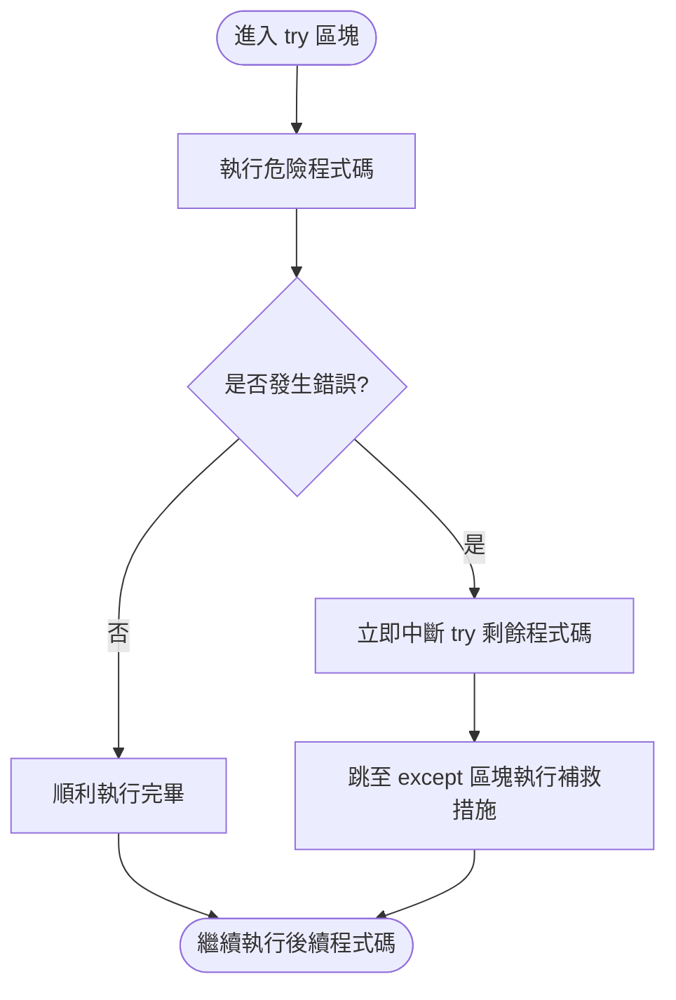
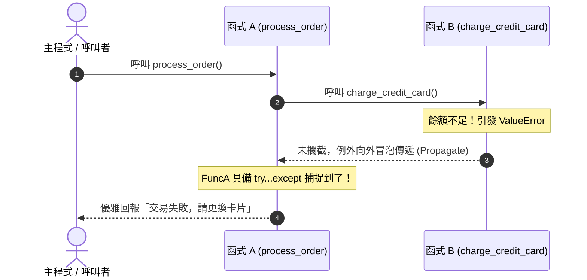
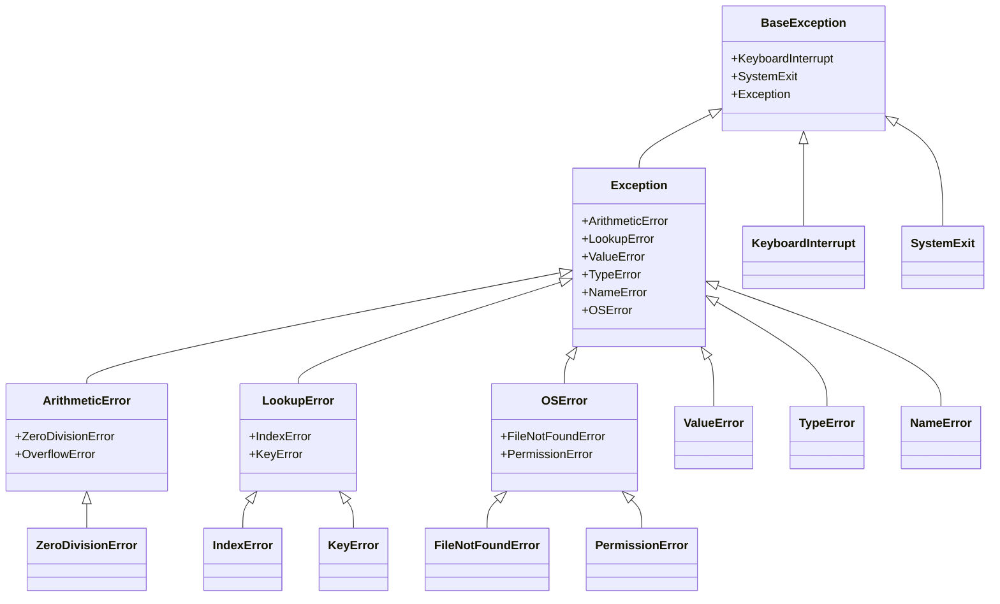

# Python 例外處理（Exception Handling）完全教學指南

在撰寫程式時，無論邏輯多麼嚴密，總會遇到意料之外的狀況：使用者輸入了非數字的字串、想要開啟的檔案不存在、網路連線突然中斷、或是除數為零。如果沒有做好防護，程式就會立即「崩潰（Crash）」並噴出一整串嚇人的錯誤訊息。

本教材以**由淺至深、循序漸進**的方式，帶領你從認識錯誤開始，學習如何使用 `try`、`except`、`else`、`finally`，到進階的 `raise` 拋出例外與自訂專案例外類別，讓你的程式具備強大的容錯能力與強韌度（Robustness）。

---

## 目錄
- [一、核心前置觀念：語法錯誤 vs 執行時期例外](#一核心前置觀念語法錯誤-vs-執行時期例外)
  - [1.1 語法錯誤（SyntaxError）](#11-語法錯誤syntaxerror)
  - [1.2 執行時期例外（Exceptions / Runtime Errors）](#12-執行時期例外exceptions--runtime-errors)
  - [1.3 為什麼需要例外處理？](#13-為什麼需要例外處理)
  - [1.4 Python 的編程哲學：EAFP vs LBYL](#14-python-的編程哲學eafp-vs-lbyl)
- [二、初探例外處理：`try ... except` 基本結構](#二初探例外處理try--except-基本結構)
  - [2.1 語法架構與流程圖](#21-語法架構與流程圖)
  - [2.2 基礎範例：處理除以零（ZeroDivisionError）](#22-基礎範例處理除以零zerodivisionerror)
  - [2.3 基礎範例：處理型別轉換錯誤（ValueError）](#23-基礎範例處理型別轉換錯誤valueerror)
- [三、精準攔截：捕捉指定例外與例外別名](#三精準攔截捕捉指定例外與例外別名)
  - [3.1 為什麼不能隨意使用「裸 `except:`」？](#31-為什麼不能隨意使用裸-except)
  - [3.2 捕捉特定例外類型](#32-捕捉特定例外類型)
  - [3.3 取得系統錯誤訊息：`as` 關鍵字](#33-取得系統錯誤訊息as-關鍵字)
  - [3.4 多個 `except` 分支（多重攔截）](#34-多個-except-分支多重攔截)
  - [3.5 一個 `except` 捕捉多種例外（Tuple 形式）](#35-一個-except-捕捉多種例外tuple-形式)
- [四、四位一體的完整結構：`try ... except ... else ... finally`](#四四位一體的完整結構try--except--else--finally)
  - [4.1 四大關鍵字角色分工](#41-四大關鍵字角色分工)
  - [4.2 `else` 區塊：沒有錯誤時的後續工作](#42-else-區塊沒有錯誤時的後續工作)
  - [4.3 `finally` 區塊：無論成敗必定執行的清理工作](#43-finally-區塊無論成敗必定執行的清理工作)
  - [4.4 完整實戰範例：檔案讀取與資源釋放](#44-完整實戰範例檔案讀取與資源釋放)
- [五、主動引發例外：`raise` 與例外傳遞](#五主動引發例外raise-與例外傳遞)
  - [5.1 為什麼需要主動報錯？](#51-為什麼需要主動報錯)
  - [5.2 使用 `raise` 引發內建例外](#52-使用-raise-引發內建例外)
  - [5.3 例外傳遞機制（Call Stack 與 Traceback）](#53-例外傳遞機制call-stack-與-traceback)
  - [5.4 重新拋出例外（Re-raising）](#54-重新拋出例外re-raising)
- [六、進階架構：自訂例外類別（Custom Exceptions）](#六進階架構自訂例外類別custom-exceptions)
  - [6.1 繼承 `Exception` 類別](#61-繼承-exception-類別)
  - [6.2 實戰範例：銀行帳戶提款系統](#62-實戰範例銀行帳戶提款系統)
  - [6.3 帶有額外狀態屬性的自訂例外](#63-帶有額外狀態屬性的自訂例外)
- [七、Python 常見內建例外速查表](#七python-常見內建例外速查表)
- [八、例外處理最佳實踐與防坑守則](#八例外處理最佳實踐與防坑守則)
- [九、課堂實戰練習與自我檢測題（附詳解）](#九課堂實戰練習與自我檢測題附詳解)

---

## 一、核心前置觀念：語法錯誤 vs 執行時期例外

在開始寫防禦性程式碼之前，我們必須先釐清程式出錯的兩大類別。

### 1.1 語法錯誤（SyntaxError）
這是程式在「編譯 / 解析（Parsing）」階段就被 Python 直譯器抓出的錯誤。當你的程式碼不符合 Python 的語法規範時（例如少冒號、括號不對稱），直譯器甚至**連執行都還沒開始**就會直接報錯終止。

```python
# 語法錯誤範例：if 後方漏掉冒號
if 5 > 3
    print("大於")
# SyntaxError: expected ':'
```
> [!IMPORTANT]
> **語法錯誤無法透過例外處理（`try...except`）來捕捉！** 你只能修改原始碼修正語法。

---

### 1.2 執行時期例外（Exceptions / Runtime Errors）
語法完全正確，直譯器能夠正常解析並開始執行程式，但在**執行過程**中遇到了不合理或非預期的狀況，導致執行中斷。

```python
# 語法正確，但執行時遇到除以零
print("程式開始")
result = 10 / 0  # 執行到這行崩潰！
print("程式結束")  # 這行永遠不會被執行
# ZeroDivisionError: division by zero
```

常見的執行時期例外包含：
- 數值轉換失敗：`int("hello")` $\rightarrow$ `ValueError`
- 除以零：`10 / 0` $\rightarrow$ `ZeroDivisionError`
- 變數未定義：`print(x)` $\rightarrow$ `NameError`
- 串列超出索引：`[1, 2][99]` $\rightarrow$ `IndexError`
- 字典鍵不存在：`{"a": 1}["b"]` $\rightarrow$ `KeyError`

---

### 1.3 為什麼需要例外處理？

若沒有例外處理：
1. 程式會直接中斷崩潰，後續流程全數停止。
2. 使用者看到一長串晦澀難懂的英文報錯（Traceback），造成恐慌與不良體驗。
3. 正在開啟的檔案、網路連線或資料庫 Transaction 可能來不及釋放或復原，導致資料損壞。

做好例外處理，能讓程式「**優雅地降級（Graceful Degradation）**」：給予友善的使用者提示、記錄錯誤日誌（Log）、釋放資源，並讓主流程能繼續平穩運作。

---

### 1.4 Python 的編程哲學：EAFP vs LBYL

在處理可能出錯的邏輯時，程式設計界有兩種主要哲學：

1. **LBYL (Look Before You Leap，三思而後行)**：
   - 傳統語言（如 C / 早期的 Java）偏好的風格。在做動作前先寫大量 `if-else` 檢查所有前提條件。
   ```python
   # LBYL 風格
   if b != 0:
       ans = a / b
   else:
       print("除數不能為零！")
   ```
2. **EAFP (Easier to Ask for Forgiveness than Permission，請求原諒比請求許可更容易)**：
   - **這是 Python 官方最推崇的核心哲學！**
   - 預設操作會成功，直接放手去執行；如果發生了例外，再來進行補救與處理。
   ```python
   # EAFP 風格 (Pythonic)
   try:
       ans = a / b
   except ZeroDivisionError:
       print("除數不能為零！")
   ```
   > [!TIP]
   > EAFP 的優點在於程式碼主邏輯清晰明快，不會被層層巢狀的 `if` 驗證淹沒，且能避免高併發環境下的「檢查與使用時間差競爭條件（TOCTOU race condition）」。

---

## 二、初探例外處理：`try ... except` 基本結構

### 2.1 語法架構與流程圖

最基本的例外處理架構由 `try` 與 `except` 組成：

```python
try:
    # 可能會發生例外的程式碼（危險區）
    ...
except:
    # 當發生例外時執行的補救程式碼（安全氣囊）
    ...
```

#### 運作流程圖


---

### 2.2 基礎範例：處理除以零（ZeroDivisionError）

我們希望設計一個除法小工具，即使使用者輸入除數為 0，程式也不會死當：

```python
def safe_divide(a, b):
    try:
        result = a / b
        print(f"計算結果：{a} / {b} = {result}")
    except ZeroDivisionError:
        print("【警告】除數不能為 0，請重新輸入！")

# 測試正常運算
safe_divide(10, 2)
# 輸出：計算結果：10 / 2 = 5.0

# 測試異常運算
safe_divide(10, 0)
# 輸出：【警告】除數不能為 0，請重新輸入！

print("程式未崩潰，依然持續運作！")
```

---

### 2.3 基礎範例：處理型別轉換錯誤（ValueError）

當我們請使用者輸入整數年齡時，使用者可能會不小心輸入文字：

```python
def ask_age():
    user_input = input("請輸入您的年齡：")
    try:
        age = int(user_input)
        print(f"您明年是 {age + 1} 歲。")
    except ValueError:
        print(f"輸入格式錯誤！「{user_input}」不是有效的整數！")

# 若輸入: 18 -> 輸出: 您明年是 19 歲。
# 若輸入: 十八 -> 輸出: 輸入格式錯誤！「十八」不是有效的整數！
```

---

## 三、精準攔截：捕捉指定例外與例外別名

### 3.1 為什麼不能隨意使用「裸 `except:`」？

初學者常貪圖方便，直接寫不帶任何型別的 `except:`：

```python
# 壞味道（Anti-Pattern）：裸 except
try:
    do_something()
except:
    print("出錯了！")
```

> [!CAUTION] 嚴正警告：避免使用裸 `except:`
> 裸 `except:` 會捕捉**所有**例外，包含：
> 1. 使用者在終端機按下 `Ctrl + C`（觸發 `KeyboardInterrupt`，你想強制停止程式都停不下來）。
> 2. 系統呼叫 `sys.exit()`（觸發 `SystemExit`）。
> 3. 打錯變數名稱的程式錯誤（`NameError`）被悄悄掩蓋，導致除錯變得極度困難！

---

### 3.2 捕捉特定例外類型

指名道姓要攔截哪一種例外，是身為專業 Python 工程師的標準基本功：

```python
try:
    num = int("abc")
except ValueError:  # 只有 ValueError 會進來
    print("抓到數值轉換錯誤！")
```

---

### 3.3 取得系統錯誤訊息：`as` 關鍵字

透過 `as 變數名稱`，我們可以把 Python 內建產生的「例外物件（Exception Object）」接住，並印出或記錄系統提供的詳細原因：

```python
try:
    scores = [95, 80, 100]
    print(scores[5])  # 索引越界
except IndexError as e:
    print(f"攔截到錯誤：{type(e).__name__}")
    print(f"系統錯誤原因：{e}")

# 輸出：
# 攔截到錯誤：IndexError
# 系統錯誤原因：list index out of range
```

---

### 3.4 多個 `except` 分支（多重攔截）

在一個 `try` 區塊中，可能會引發多種不同類型的錯誤。我們可以使用多個 `except` 區塊分別進行不同處置（類似 `if ... elif ...` 的邏輯）：

```python
def calculate_average(score_strings):
    try:
        # 可能引發 ValueError（轉換失敗）
        total = sum(int(s) for s in score_strings)
        # 可能引發 ZeroDivisionError（清單為空）
        avg = total / len(score_strings)
        print(f"平均分數為：{avg:.2f}")
        
    except ValueError as e:
        print(f"【輸入錯誤】成績資料包含無效文字：{e}")
        
    except ZeroDivisionError:
        print("【統計錯誤】成績清單不可為空！")
        
    except Exception as e:
        # Exception 是所有一般錯誤的父類別，放在最後兜底（Fallback）
        print(f"【未知系統錯誤】：{e}")

# 測試 1：正常
calculate_average(["90", "80", "100"])  # 平均分數為：90.00

# 測試 2：非數字
calculate_average(["90", "ABC", "100"]) # 【輸入錯誤】成績資料包含無效文字：invalid literal for int()...

# 測試 3：空清單
calculate_average([])                  # 【統計錯誤】成績清單不可為空！
```

> [!NOTE] 攔截順序的重要性
> Python 由上往下比對 `except`。因此**子類別（範圍較小、具體的錯誤）必須寫在上方，父類別（範圍較廣的 `Exception`）必須寫在最下方**。若將 `except Exception` 寫在第一行，後續所有具體的 `except` 都將永遠不會被執行。

---

### 3.5 一個 `except` 捕捉多種例外（Tuple 形式）

若兩種不同的例外處理方式完全一樣，可以用小括號 `()` 將它們打包成一個 Tuple：

```python
def fetch_item(data_list, index_str):
    try:
        idx = int(index_str)
        print(f"取得元素：{data_list[idx]}")
    except (ValueError, IndexError) as err:
        # 無論是轉型失敗還是索引越界，都給予相同提示
        print(f"查詢失敗！請傳入合法的索引整數。（錯誤訊息：{err}）")

items = ["蘋果", "香蕉", "橘子"]
fetch_item(items, "99")   # 查詢失敗！請傳入合法的索引整數。（錯誤訊息：list index out of range）
fetch_item(items, "貓咪") # 查詢失敗！請傳入合法的索引整數。（錯誤訊息：invalid literal for int()...）
```

---

## 四、四位一體的完整結構：`try ... except ... else ... finally`

Python 的例外處理語法最完整可擴充至四個部分：

```python
try:
    # 1. 嘗試執行的程式碼（危險區）
    ...
except SomeException:
    # 2. 發生例外時才執行
    ...
else:
    # 3. 完全沒有發生任何例外時才執行
    ...
finally:
    # 4. 無論是否發生例外，最後一定會執行
    ...
```

### 4.1 四大關鍵字角色分工

| 關鍵字 | 執行時機 | 主要用途與常見場景 |
| :--- | :--- | :--- |
| **`try`** | 一律最先執行 | 放置最核心且可能拋出例外的操作。儘量保持簡短。 |
| **`except`** | 僅在 `try` 區塊**拋出匹配的例外**時執行 | 錯誤處理、記錄 Log、提供預設值或錯誤提示。 |
| **`else`** | 僅在 `try` 區塊**順利完成（無任何例外）**時執行 | 當操作成功後才要進行的後續動作，避免非危險程式碼誤塞進 `try`。 |
| **`finally`** | **無論成功、失敗、甚至是中途 `return`**，保證最後必定執行 | 釋放外部資源、關閉檔案連線、資料庫連線復原、清理暫存。 |

---

### 4.2 `else` 區塊：沒有錯誤時的後續工作

許多初學者會問：「為什麼不直接把後續邏輯寫在 `try` 區塊的末端就好了？」

**原因：保持 `try` 區塊的精準最小化。**  
若把過多無關的程式碼塞入 `try` 中，後續程式碼引發的意外錯誤可能會被不該攔截的 `except` 誤抓，增加除錯困難。

```python
# 示範 else 的語意清晰度
try:
    age = int(input("請輸入年齡："))
except ValueError:
    print("輸入的不是數字！")
else:
    # 只有在 int() 成功時才執行，確保 age 一定存在且為整數
    if age >= 18:
        print("成年人，具備投票權。")
    else:
        print("未成年。")
```

---

### 4.3 `finally` 區塊：無論成敗必定執行的清理工作

`finally` 具有最高的執行保證。即使 `try` 或 `except` 裡面寫了 `return`、`break`，`finally` 也一定會在函式返回前搶先執行！

```python
def test_finally():
    try:
        print("1. 進入 try")
        return "回傳值：try 成功"
    except Exception:
        print("2. 進入 except")
    finally:
        print("3. 無論如何都會印出的 finally！")

result = test_finally()
print(result)

# 終端輸出：
# 1. 進入 try
# 3. 無論如何都會印出的 finally！
# 回傳值：try 成功
```

---

### 4.4 完整實戰範例：檔案讀取與資源釋放

以下示範經典的檔案讀取與統計範例：

```python
def read_and_count_words(file_path):
    file = None
    try:
        print(f"嘗試開啟檔案：{file_path}")
        file = open(file_path, "r", encoding="utf-8")
        content = file.read()
        word_count = len(content.split())
        
    except FileNotFoundError:
        print(f"【錯誤】找不到檔案：'{file_path}'，請確認路徑。")
        word_count = 0
        
    except UnicodeDecodeError:
        print(f"【錯誤】檔案編碼不是 utf-8，無法正確解碼。")
        word_count = 0
        
    else:
        print(f"【成功】讀取完成，檔案內共有 {word_count} 個單詞。")
        
    finally:
        if file is not None and not file.closed:
            file.close()
            print("【資源釋放】檔案串流已安全關閉。")
        else:
            print("【資源清理】無需關閉檔案。")

# 測試找不到檔案的情境
read_and_count_words("non_existent_file.txt")
```

> [!TIP]
> 在現代 Python 中，處理檔案通常推薦使用 `with open(...)` 的 Context Manager 語法，它底層正是幫我們自動封裝了 `finally` 的關閉邏輯！

---

## 五、主動引發例外：`raise` 與例外傳遞

除了被動等待 Python 拋出錯誤，我們也可以主動使用 **`raise`** 宣告狀態異常。

### 5.1 為什麼需要主動報錯？

當函式接收到的參數不符合商業邏輯時（例如年齡傳入負數、密碼長度不足、餘額透支），雖然語法合法，但若放任錯誤資料繼續往下計算，會引發更深層、更難追查的邏輯 Bug。此時「**儘早失敗（Fail Early）**」是優秀工程師的良好習慣。

---

### 5.2 使用 `raise` 引發內建例外

語法：`raise 例外類別("錯誤訊息描述")`

```python
def register_user(username, age):
    if not username or len(username.strip()) == 0:
        raise ValueError("使用者名稱不可為空或純空白！")
    
    if age < 0 or age > 150:
        raise ValueError(f"不合理的年齡值：{age}，年齡必須介於 0 到 150 之間！")
        
    print(f"註冊成功：{username}，{age} 歲。")

# 測試主動拋出例外
try:
    register_user("小明", -5)
except ValueError as err:
    print(f"註冊遭到拒絕：{err}")

# 輸出：註冊遭到拒絕：不合理的年齡值：-5，年齡必須介於 0 到 150 之間！
```

---

### 5.3 例外傳遞機制（Call Stack 與 Traceback）

當一個函式發生例外且未在內部被 `except` 捕捉時，這個例外會沿著**呼叫堆疊（Call Stack）**一路向上層傳遞，直到有人捕捉它為止。若傳到最外層全域仍無人處理，程式才會宣告終止並印出 Traceback。



程式碼範例：
```python
def step_three():
    # 最底層引發錯誤
    raise ConnectionError("網路連線超時！")

def step_two():
    step_three()

def step_one():
    step_two()

# 在最頂層統一攔截
try:
    step_one()
except ConnectionError as e:
    print(f"於最上層捕獲底層連線異常：{e}")
```

---

### 5.4 重新拋出例外（Re-raising）

有時我們需要在中途攔截例外記錄 Log，但記錄完後希望「**原封不動繼續往上丟**」，讓外層系統知曉。此時只需在 `except` 內單獨寫一個 `raise`：

```python
def process_payment(amount):
    try:
        # 假設進行危險的金流扣款
        if amount <= 0:
            raise ValueError("扣款金額必須大於 0")
    except ValueError as e:
        print(f"[內部日誌 Audit Log] 扣款異常記錄：{e}")
        raise  # 重新拋出當前的同一個例外！

# 外層呼叫者
try:
    process_payment(-100)
except ValueError:
    print("通知使用者：交易未授權或參數異常！")
```

---

## 六、進階架構：自訂例外類別（Custom Exceptions）

當專案規模擴大時，僅靠內建的 `ValueError`、`TypeError` 往往無法清晰傳達業務語意。透過建立「**自訂例外類別**」，能讓模組的錯誤定義更具可讀性與維護性。

### 6.1 繼承 `Exception` 類別

在 Python 中自訂例外非常簡單，只需繼承內建的 `Exception`（切記不要直接繼承 `BaseException`）：

```python
# 定義一個專屬於應用程式的例外
class ApplicationError(Exception):
    """應用程式基礎例外"""
    pass

class DatabaseConnectionError(ApplicationError):
    """資料庫連線例外"""
    pass
```

---

### 6.2 實戰範例：銀行帳戶提款系統

我們建立一個銀行帳戶類別，並定義專門的業務例外：

```python
# 1. 建立自訂例外
class BankingError(Exception):
    """銀行系統基礎例外"""
    pass

class InsufficientFundsError(BankingError):
    """餘額不足例外"""
    pass

class NegativeAmountError(BankingError):
    """交易金額為負數例外"""
    pass

# 2. 業務類別
class BankAccount:
    def __init__(self, owner, balance=0):
        self.owner = owner
        self.balance = balance

    def withdraw(self, amount):
        if amount <= 0:
            raise NegativeAmountError(f"提款金額 ({amount}) 必須大於 0！")
        if amount > self.balance:
            raise InsufficientFundsError(
                f"帳戶餘額不足！當前餘額：{self.balance} 元，嘗試提款：{amount} 元"
            )
        self.balance -= amount
        print(f"提款成功！提款金額：{amount} 元，剩餘餘額：{self.balance} 元")

# 3. 測試呼叫與分類捕捉
account = BankAccount("Alice", balance=1000)

for test_amount in [-500, 2000, 300]:
    try:
        print(f"\n--- 嘗試提款 {test_amount} 元 ---")
        account.withdraw(test_amount)
    except NegativeAmountError as e:
        print(f"【輸入無效】：{e}")
    except InsufficientFundsError as e:
        print(f"【交易拒絕】：{e}")
    except BankingError as e:
        print(f"【銀行一般錯誤】：{e}")
```

---

### 6.3 帶有額外狀態屬性的自訂例外

我們還可以覆寫 `__init__`，讓例外物件攜帶豐富的結構化診斷資料：

```python
class ApiRequestError(Exception):
    def __init__(self, status_code, message, payload=None):
        super().__init__(f"HTTP {status_code}: {message}")
        self.status_code = status_code
        self.message = message
        self.payload = payload or {}

# 模擬使用情境
try:
    raise ApiRequestError(404, "找不到指定的資源項目", {"item_id": 9527})
except ApiRequestError as err:
    print(f"錯誤碼：{err.status_code}")
    print(f"錯誤說明：{err.message}")
    print(f"請求附帶參數：{err.payload}")
```

---

## 七、Python 常見內建例外速查表

Python 的例外是以類別繼承樹（Class Hierarchy）建構的。以下是常用例外分類與發生情境對照表：



| 例外名稱 | 所屬父類別 | 常見觸發情境 | 範例程式碼 |
| :--- | :--- | :--- | :--- |
| **`ValueError`** | `Exception` | 傳入型態正確但內容不合法的引數 | `int("xyz")`、`math.sqrt(-1)` |
| **`TypeError`** | `Exception` | 運算或函式套用在不相容的資料型別上 | `'abc' + 123`、`len(100)` |
| **`ZeroDivisionError`** | `ArithmeticError` | 任何數值除以零或取模為零 | `5 / 0`、`10 % 0` |
| **`IndexError`** | `LookupError` | 序列型別（list/tuple）索引值超出有效範圍 | `[1, 2][5]` |
| **`KeyError`** | `LookupError` | 存取字典中不存在的 key | `{'name': 'Tom'}['age']` |
| **`FileNotFoundError`** | `OSError` | 嘗試開啟不存在的實體檔案路徑 | `open("no_such_file.txt")` |
| **`NameError`** | `Exception` | 嘗試使用未曾宣告或賦值的變數名稱 | `print(undefined_variable)` |
| **`AttributeError`** | `Exception` | 存取物件不存在的屬性或方法 | `"hello".uppercase()`（字串應為 `.upper()`） |
| **`KeyboardInterrupt`** | `BaseException` | 使用者在鍵盤按下中斷鍵（如 `Ctrl + C`） | *非正常程式錯誤，勿輕易吞掉* |

---

## 八、例外處理最佳實踐與防坑守則

1. **絕不使用「靜音吞噬（Silent Swallowing）」**：
   ```python
   # 嚴重的壞習慣：讓所有 Bug 銷聲匿跡，日後完全無法除錯
   try:
       do_critical_job()
   except Exception:
       pass  # 千萬不要這麼做！至少要 print 或 log 出來！
   ```
2. **`try` 區塊越小越好**：
   只把真正有風險的語句放入 `try`，非高風險運算挪到 `else` 或外部。
3. **優先捕捉最具體的例外**：
   先 `IndexError` 後 `LookupError`，最後才是 `Exception`。
4. **善用 `with` 上下文管理器**：
   檔案、鎖（Lock）、資料庫連線等資源優先使用 `with` 語句，它能自動替你做好 `finally` 的關閉工作。
5. **別把例外處理當作常態 `if-else` 流程控制濫用**：
   例外處理的底層開銷比單純的布林比較略高，應保留給「例外」或「非預期」的異常狀態，而非作為常規迴圈的終止手段。

---

## 九、課堂實戰練習與自我檢測題（附詳解）

### 題目一：觀念辨析（單選題）
觀察以下程式碼結構：
```python
try:
    print("步驟 A")
    x = 10 / 2
except ZeroDivisionError:
    print("步驟 B")
else:
    print("步驟 C")
finally:
    print("步驟 D")
```
請問終端機輸出的**正確順序**為何？
- (A) 步驟 A $\rightarrow$ 步驟 B $\rightarrow$ 步驟 D
- (B) 步驟 A $\rightarrow$ 步驟 C $\rightarrow$ 步驟 D
- (C) 步驟 A $\rightarrow$ 步驟 C
- (D) 步驟 A $\rightarrow$ 步驟 D

> **【題目一 詳解】**：  
> 正確答案為 **(B)**。  
> **解析**：
> 1. 進入 `try`，印出「步驟 A」。
> 2. `x = 10 / 2 = 5.0`，沒有任何錯誤發生。
> 3. 因為沒有錯誤，跳過 `except`（不印步驟 B）。
> 4. 因 `try` 完全成功，觸發 `else` 區塊，印出「步驟 C」。
> 5. 最後無論成功失敗，必執行 `finally`，印出「步驟 D」。
> 因此輸出為 A $\rightarrow$ C $\rightarrow$ D。

---

### 題目二：程式追蹤（閱讀理解題）
觀察以下巢狀函式與例外傳遞程式碼，試推導最後的螢幕輸出：

```python
def check_score(score):
    if score < 0:
        raise ValueError("分數不可為負")
    return score + 10

def evaluate():
    try:
        val = check_score(-5)
        print(f"調整後分數：{val}")
    except ValueError as e:
        print(f"抓到評分錯誤：{e}")
        return 0
    finally:
        print("評分流程結束")

result = evaluate()
print(f"最終回傳值：{result}")
```

> **【題目二 詳解】**：  
> **輸出結果**：
> ```text
> 抓到評分錯誤：分數不可為負
> 評分流程結束
> 最終回傳值：0
> ```
> **解析步驟**：
> 1. `evaluate()` 呼叫 `check_score(-5)`。
> 2. `check_score` 發現 `-5 < 0`，拋出 `ValueError("分數不可為負")`。
> 3. `evaluate` 的 `except ValueError as e:` 成功捕捉到錯誤，印出 `抓到評分錯誤：分數不可為負`。
> 4. 雖然緊接著遇到 `return 0`，但 Python 規定 **`finally` 必須在函式退出前執行**，因此先印出 `評分流程結束`。
> 5. 函式正式回傳 `0`，最後主程式印出 `最終回傳值：0`。

---

### 題目三：除錯實戰（找出程式碼的缺陷）
以下這段程式碼的目的是「讓使用者重複輸入，直到輸入合法的浮點數溫度為止」，但程式碼寫法有重大缺陷：

```python
# 待除錯的程式碼
def get_temperature():
    while True:
        try:
            temp = float(input("請輸入當前氣溫(°C)："))
            return temp
        except:
            print("請輸入有效的數字！")
```

**問題**：這段程式碼有什麼潛在危機？請提出改進方案。

> **【題目三 詳解】**：  
> **缺陷分析**：  
> 程式碼使用了**裸 `except:`**。如果使用者想要強行終止程式，在鍵盤按下 `Ctrl + C`，產生的 `KeyboardInterrupt` 也會被當成一般輸入錯誤捕捉，導致無窮迴圈無法跳出，必須強制殺死行程（Kill Process）才能停止。  
> 
> **改進後正確程式碼**：
> ```python
> def get_temperature():
>     while True:
>         try:
>             temp = float(input("請輸入當前氣溫(°C)："))
>             return temp
>         except ValueError:  # 明確只捕捉型態轉換錯誤
>             print("輸入格式錯誤，請輸入有效的數字！\n")
> ```

---

### 題目四：動手實作（綜合情境題）

**情境需求**：
請設計一個名為 `safe_json_loader(json_str, required_keys)` 的函式：
1. 使用 Python 內建的 `json.loads(json_str)` 解析傳入的字串。
2. 若字串格式不符合 JSON 規格（會引發 `json.JSONDecodeError`），請捕捉並回報「JSON 格式解析失敗」。
3. 解析成功後，檢查 `required_keys` 清單中的每個欄位是否存在於解析出來的字典中。若有任何缺少，請主動 `raise KeyError(f"缺少必要欄位：{key}")`。
4. 若一切正確無誤，印出「資料驗證成功」，並回傳該字典。
5. 無論成功或失敗，在 `finally` 區塊中印出「驗證程序結束」。

#### 參考解答：
```python
import json

def safe_json_loader(json_str, required_keys):
    try:
        data = json.loads(json_str)
    except json.JSONDecodeError as err:
        print(f"【解析錯誤】JSON 格式不合法：{err}")
        return None
    else:
        # JSON 解析成功，接續進行欄位完整性驗證
        try:
            for key in required_keys:
                if key not in data:
                    raise KeyError(f"缺少必要欄位：'{key}'")
        except KeyError as key_err:
            print(f"【驗證失敗】：{key_err}")
            return None
        else:
            print("【驗證成功】所有必要欄位皆齊全！")
            return data
    finally:
        print("--> [Audit] 驗證程序結束\n")

# --- 測試案例 ---
# 測試 1：正常合法資料
valid_json = '{"name": "王小明", "age": 20, "email": "wang@example.com"}'
safe_json_loader(valid_json, ["name", "age"])

# 測試 2：JSON 語法破損
broken_json = '{"name": "王小明", "age": 20'  # 漏掉結尾大括號
safe_json_loader(broken_json, ["name"])

# 測試 3：缺少必要欄位
missing_key_json = '{"name": "王小明"}'
safe_json_loader(missing_key_json, ["name", "age"])
```
