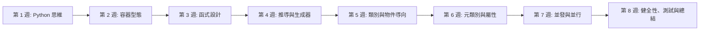

# Python 進階實踐與程式碼品質讀書會企劃書
**共讀書目：《Effective Python：90 個編寫高品質 Python 的具體技巧》（第二版）**

---

## 一、 企劃緣起與宗旨

在具備 Python 基礎語法與撰寫簡單腳本的能力後，許多開發者在實務專案常面臨以下挑戰：
- 寫出過度複雜或難以維護的「非 Pythonic」程式碼。
- 對生成器、裝飾器、元類別或並行處理（Concurrency）的底層原理不夠熟悉，難以在關鍵架構做出正確取捨。
- 缺乏團隊統一的程式碼品質意識與測試重構習慣。

本讀書會旨在透過**「經典共讀、範例演練、經驗交流」**三位一體的模式，號召同儕一起深入探討 Python 的核心思維與優雅寫法，建立可維護、高效能且具備良好工程素養的開發實踐。

---

## 二、 讀書會基本資訊

| 項目 | 詳細說明 |
| :--- | :--- |
| **主要教材** | 《Effective Python: 90 Specific Ways to Write Better Python (2nd Edition)》 |
| **預計期程** | 共 8 週（每週 1 次，每次約 60 ~ 90 分鐘） |
| **活動時間** | 每週三晚間 19:30 – 21:00（預計自 2026 年 12 月初啟動） |
| **進行形式** | 線上視訊會議（Google Meet / Microsoft Teams） |
| **小組規模** | 精實核心制（4 ~ 6 人） |
| **先備知識** | 熟悉 Python 基礎語法（資料型態、控制流程、函式定義、基本物件概念） |
| **產出形式** | Git 儲存庫共筆文件（Markdown 研讀筆記）與可執行範例程式碼（Python + pytest） |

---

## 三、 8 週研讀進度規劃

教材共有 10 個核心主題、90 條具體建議，將依重要性與關聯度濃縮為 8 週精實模組：



| 週次 | 主題模組 | 研讀範圍（Item 建議項） | 核心學習重點 |
| :---: | :--- | :--- | :--- |
| **W1** | **Python 思維精神 (Pythonic Thinking)** | Item 1 ~ 10 | • Python 版本與語法風格規範 (PEP 8)<br>• bytes、str 與編碼轉換細節<br>• f-string、輔助函式與切片技巧<br>• 海象運算子 (`:=`) 的適當時機 |
| **W2** | **清單與字典 (Lists and Dictionaries)** | Item 11 ~ 18 | • 避免複雜切片與 stride 陷阱<br>• 善用解包 (Unpacking) 與 star 表達式<br>• `sort()` 與 `key` 參數應用<br>• `dict` 插入順序、`defaultdict` 與 missing 機制 |
| **W3** | **函式設計與引數控制 (Functions)** | Item 19 ~ 26 | • 解包引數與位置／關鍵字參數控制 (`/` 與 `*`)<br>• 動態預設引數的 None 慣用法<br>• 閉包（Closure）與變數作用域陷阱<br>• `functools.wraps` 正確定義裝飾器 |
| **W4** | **推導式與生成器 (Comprehensions & Generators)** | Item 27 ~ 36 | • 列表／字典推導式的清晰度原則<br>• 善用生成器運算式避免耗盡記憶體<br>• `yield from` 組合多個生成器<br>• `itertools` 內建模組高效工具庫 |
| **W5** | **類別與介面設計 (Classes and Interfaces)** | Item 37 ~ 43 | • 善用組合（Composition）而非多層繼承<br>• Mix-in 類別的多載實作<br>• `super()` 正確初始化菱形繼承架構<br>• `collections.abc` 自訂標準容器介面 |
| **W6** | **元類別與屬性控制 (Metaclasses & Attributes)** | Item 44 ~ 51 | • 使用 Plain Attribute 代替 getter/setter<br>• `@property` 的使用原則與邊界<br>• 描述器（Descriptor）的運作機制<br>• `__init_subclass__` 取代複雜 Metaclass |
| **W7** | **並發與並行 (Concurrency and Parallelism)** | Item 52 ~ 64 | • GIL 機制對多執行緒（Thread）的影響<br>• `subprocess` 處理外部程序<br>• `concurrent.futures` 執行緒池與程序池<br>• `asyncio` 協程、事件迴圈與非同步 I/O |
| **W8** | **程式健全性、測試與成果回顧** | Item 65 ~ 90 (精選) | • `try/except/else/finally` 完整錯誤處理<br>• `unittest` / `pytest` 測試與 Mock 技巧<br>• 效能剖析 (`cProfile`) 與記憶體調優<br>• 全員成果交流與心得回顧 |

---

## 四、 聚會流程與運作模式

每次讀書會時間為 **75 分鐘**，採「輪值導讀制」，確保每位成員皆有深度輸入與輸出機會。

### 1. 單次會議流程配比

| 時間 | 環節 | 內容說明 | 負責人 |
| :---: | :--- | :--- | :---: |
| **19:30 - 19:35 (5 min)** | 開場暖身 | 確認連線、回顧前週待辦或爭議點 | 主持人 |
| **19:35 - 20:05 (30 min)** | 章節重點導讀 | 提煉章節核心原則、Dos & Don'ts 對比解析 | 當週導讀人 |
| **20:05 - 20:25 (20 min)** | 程式碼 Live Demo | 運行具體範例程式、展示不同寫法的效能或行為差異 | 當週導讀人 |
| **20:25 - 20:45 (20 min)** | 自由提問與實務探討 | 結合各成員目前專案經驗進行 Code Review 或討論 | 全體成員 |
| **20:45 - 20:50 (5 min)** | 結尾與交接 | 紀錄當週 Action Items、確認下週導讀人與進度 | 主持人 |

### 2. 角色職責

- **導讀人（當週輪值）**：
  - 於聚會前 **2 天**將章節 Markdown 筆記與範例 code 提交至 Git 儲存庫。
  - 會議中主講 30 分鐘重點精華與 20 分鐘範例實作。
- **與會成員**：
  - 會前預習當週指派章節，並至少準備 **1 個問題或工作實務經驗** 參與討論。
  - 積極參與發問與交流，給予導讀人即時反饋。

---

## 五、 Git 儲存庫協作與產出架構

讀書會所有產出均納入 Git 版本控制，建議專案目錄結構如下：

```text
book-club-effective-python/
├── README.md               # 讀書會總覽、章節連結與成員名單
├── book-club.md            # 本企劃書
├── docs/                   # 每週共筆 Markdown 檔案
│   ├── week-01-pythonic-thinking.md
│   ├── week-02-lists-and-dicts.md
│   └── ...
├── src/                    # 範例程式碼目錄
│   ├── week01/
│   │   ├── item01_pep8_rules.py
│   │   └── item08_zip_longest.py
│   └── ...
└── tests/                  # 單元測試範例
    ├── test_week01.py
    └── ...
```

### Git 協作約定：
1. **Branch 命名**：導讀人開立 `feature/week-XX-topic` 分支進行撰寫。
2. **Pull Request**：會前發起 PR，供其他成員線上留言 review 與預習。
3. **Commit 訊息**：遵循 Conventional Commits（例如：`docs: add week 2 notes for dict sorting`、`feat: add example code for generators`）。

---

## 六、 公約與出席機制

為了維持讀書會的高品質討論與良好節奏，全體成員共同承諾遵守以下規範：

1. **誠信與出席責任**：小組人數精實（4 ~ 6 人），每位成員的發言與出席至關重要。
2. **請假原則**：若因不可抗力需請假，請至少提早 **24 小時** 於群組內告知。
3. **補課機制**：缺席成員須在下次會議前觀看會議錄影／筆記，並於 PR 補上至少 100 字的心得或疑問留言。
4. **互助與包容**：鼓勵提問與探究底層細節，保持開放心態互相學習。

---

## 七、 預期成果與結業效益

完成 8 週讀書會後，參與成員將具備以下實質收穫：
1. **撰寫道地的 Python 程式碼**：熟練掌握 Pythonic 慣用法，大幅提升個人與團隊程式碼的可讀性與優雅度。
2. **厚實底層機制的理解**：透徹理解記憶體配置、裝飾器閉包、生成器迭代協定與非同步並行機制。
3. **建立完整的知識資產庫**：累積 8 份系統化 Markdown 筆記與數十個可直接測試、復用的範例 Codebase。
4. **提升 Code Review 與架構思維**：在職場或專案開發中，能有憑有據地給予團隊實質且建設性的設計建議。

---

## 八、 籌備期程與後續行動

- [ ] **T - 10 天**：公佈企劃書，完成 4 ~ 6 位成員召募確認。
- [ ] **T - 5 天**：成立線上溝通群組，確認每週固定會議時段。
- [ ] **T - 3 天**：召開 15 分鐘線上行前會，排定第 1 ~ 8 週導讀人輪值表，並建立 Git 儲存庫。
- [ ] **T 日**：第一週讀書會正式開跑！
