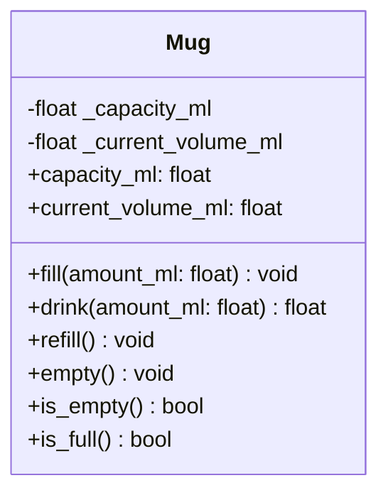

# Python 物件導向與生活實踐：一個馬克杯的容量與類別設計指南

在日常生活與工程軟體設計中，「容器（Container）」與「容量（Capacity）」是非常經典的物件模型。本篇教學以**「一個馬克杯的容量」**為主題，結合日常常識、幾何數學計算、Python 物件導向程式設計（OOP）以及防禦性例外處理，帶你循序漸進掌握 Python Class（類別）的核心用法。

---

## 目錄
- [一、生活常識：一個馬克杯的容量究竟是多少？](#一生活常識一個馬克杯的容量究竟是多少)
  - [1.1 常見馬克杯規格標準](#11-常見馬克杯規格標準)
  - [1.2 常見容量單位換算表](#12-常見容量單位換算表)
- [二、數學與幾何建模：如何計算馬克杯容積？](#二數學與幾何建模如何計算馬克杯容積)
  - [2.1 圓柱體容積計算公式](#21-圓柱體容積計算公式)
  - [2.2 Python 幾何計算函式實作](#22-python-幾何計算函式實作)
- [三、物件導向實戰：打造 `Mug`（馬克杯）類別](#三物件導向實戰打造-mug馬克杯類別)
  - [3.1 為什麼需要封裝成類別（Class）？](#31-為什麼需要封裝成類別class)
  - [3.2 類別設計與架構圖](#32-類別設計與架構圖)
  - [3.3 核心程式碼實作](#33-核心程式碼實作)
- [四、防禦性程式設計：例外處理與邊界防護](#四防禦性程式設計例外處理與邊界防護)
  - [4.1 注入水量溢出（OverflowError）](#41-注入水量溢出overflowerror)
  - [4.2 無效數值輸入（ValueError）](#42-無效數值輸入valueerror)
- [五、自動化單元測試（Unit Testing）](#五自動化單元測試unit-testing)
  - [5.1 測試案例規劃](#51-測試案例規劃)
  - [5.2 使用 uv 虛擬環境執行測試](#52-使用-uv-虛擬環境執行測試)
- [六、重點總結](#六重點總結)

---

## 一、生活常識：一個馬克杯的容量究竟是多少？

### 1.1 常見馬克杯規格標準

馬克杯（Mug）並沒有單一法定的絕對容量，但國際餐飲與居家日常有非常普遍的通用標準：

| 規格類別 | 容量範圍（毫升 / ml） | 美制液體盎司（fl oz） | 常見用途與特色 |
| :--- | :--- | :--- | :--- |
| **小容量馬克杯** | 200 ~ 250 ml | 6 ~ 8 fl oz | 雙份濃縮咖啡、卡布奇諾、小份英式茶 |
| **標準馬克杯（Standard）** | **300 ~ 350 ml** | **10 ~ 12 fl oz** | **市售最常見的標準尺寸**，辦公室泡茶、美式黑咖啡常用 |
| **大容量馬克杯（Large）** | 400 ~ 500 ml | 14 ~ 16 fl oz | 星巴克 Grande (16 oz)、拿鐵、大容量飲水 |
| **特大容量（Jumbo / Soup Mug）** | 500 ml 以上 | 18+ fl oz | 沖泡燕麥粥、濃湯、大杯茶飲 |

> [!NOTE]
> 在軟體工程建模時，我們通常將標準馬克杯容量設定為常數 **350 ml**。

### 1.2 常見容量單位換算表

- $1\text{ ml} = 1\text{ cc} = 1\text{ cm}^3$（立方公分）
- $1\text{ 美制液體盎司 (fl oz)} \approx 29.5735\text{ ml}$
- 標準 $12\text{ fl oz} \approx 354.88\text{ ml}$（商業上多標示為 350 ml）

---

## 二、數學與幾何建模：如何計算馬克杯容積？

### 2.1 圓柱體容積計算公式

大部分馬克杯為圓柱體（或接近圓柱體）。若已知馬克杯的內徑半徑 $r$ 與內部高度 $h$（單位均為公分 $\text{cm}$）：

$$V = \pi \times r^2 \times h$$

因為 $1\text{ cm}^3 = 1\text{ ml}$，計算出的體積數值即為容量毫升數。

### 2.2 Python 幾何計算函式實作

在 `calc.py` 或 `mug.py` 中，我們可以使用 Python 內建的 `math.pi` 進行精準計算，並加入輸入驗證：

```python
import math

def calculate_cylinder_capacity(radius_cm: float, height_cm: float) -> float:
    """以內徑半徑與內高（公分）計算圓柱形馬克杯的容積（毫升）。
    
    若半徑或高度小於或等於 0，主動拋出 ValueError。
    """
    if radius_cm <= 0 or height_cm <= 0:
        raise ValueError("半徑與高度必須大於 0")
    volume = math.pi * (radius_cm ** 2) * height_cm
    return round(volume, 2)
```

---

## 三、物件導向實戰：打造 `Mug`（馬克杯）類別

### 3.1 為什麼需要封裝成類別（Class）？

若僅使用字典或一般變數記錄水量，容易發生以下問題：
- 水量可能不小心被改成負數（例如 `-50 ml`）。
- 倒入的水量可能超過杯子極限，造成邏輯上的「無限裝水」。

透過封裝成類別，我們可以把**屬性（狀態）**與**方法（行為）**緊密結合，對外界提供安全的介面。

### 3.2 類別設計與架構圖



### 3.3 核心程式碼實作

```python
DEFAULT_MUG_CAPACITY_ML: float = 350.0

class Mug:
    """馬克杯類別，負責管理馬克杯容量與當前水量狀態。"""

    def __init__(self, capacity_ml: float = DEFAULT_MUG_CAPACITY_ML):
        if capacity_ml <= 0:
            raise ValueError("馬克杯容量必須大於 0 ml")
        self._capacity_ml: float = float(capacity_ml)
        self._current_volume_ml: float = 0.0

    @property
    def capacity_ml(self) -> float:
        return self._capacity_ml

    @property
    def current_volume_ml(self) -> float:
        return self._current_volume_ml

    def fill(self, amount_ml: float) -> None:
        """倒水入杯。超出容量時拋出 OverflowError。"""
        if amount_ml <= 0:
            raise ValueError("倒入的水量必須大於 0 ml")
        if self._current_volume_ml + amount_ml > self._capacity_ml:
            raise OverflowError("水溢出來了！超出馬克杯容量")
        self._current_volume_ml += amount_ml

    def drink(self, amount_ml: float) -> float:
        """喝水。回傳實際喝掉的毫升數。"""
        if amount_ml <= 0:
            raise ValueError("喝掉的水量必須大於 0 ml")
        actual_drunk = min(amount_ml, self._current_volume_ml)
        self._current_volume_ml -= actual_drunk
        return actual_drunk

    def refill(self) -> None:
        """加滿水。"""
        self._current_volume_ml = self._capacity_ml

    def empty(self) -> None:
        """倒空水。"""
        self._current_volume_ml = 0.0

    def is_empty(self) -> bool:
        return self._current_volume_ml == 0.0

    def is_full(self) -> bool:
        return self._current_volume_ml >= self._capacity_ml
```

---

## 四、防禦性程式設計：例外處理與邊界防護

在軟體工程中，例外處理能防止程式發生未預期的崩潰：

### 4.1 注入水量溢出（OverflowError）
當使用者試圖倒入超出杯子容量的水時，程式不會無條件接受，而是拋出 `OverflowError`：
```python
mug = Mug(350)
mug.fill(200)
try:
    mug.fill(200)  # 200 + 200 = 400 > 350
except OverflowError as e:
    print(f"警告：{e}")
```

### 4.2 無效數值輸入（ValueError）
容量或加水量為非正數時，即時攔截並拋出 `ValueError`：
```python
try:
    bad_mug = Mug(-100)
except ValueError as e:
    print(f"參數錯誤：{e}")
```

---

## 五、自動化單元測試（Unit Testing）

單元測試是確保程式碼正確性的基石。本專案使用 Python 標準庫 `unittest`。

### 5.1 測試案例範例

```python
import unittest
from mug import Mug

class TestMug(unittest.TestCase):
    def test_default_capacity(self):
        mug = Mug()
        self.assertEqual(mug.capacity_ml, 350.0)

    def test_overflow_protection(self):
        mug = Mug(300.0)
        mug.fill(200.0)
        with self.assertRaises(OverflowError):
            mug.fill(150.0)

    def test_drink_more_than_current(self):
        mug = Mug(300.0)
        mug.fill(100.0)
        drunk = mug.drink(150.0)
        self.assertEqual(drunk, 100.0)  # 只能喝到杯中現有的 100 ml
        self.assertTrue(mug.is_empty())
```

### 5.2 使用 uv 虛擬環境執行測試

在專案目錄下使用 `uv` 執行測試套件：

```powershell
cd 2026_11_25
uv run python -m unittest discover -s tests -v
```

執行結果全數通過（OK）：
```text
test_calculate_cylinder_capacity_normal (test_mug.TestMugModule.test_calculate_cylinder_capacity_normal) ... ok
test_mug_drink (test_mug.TestMugModule.test_mug_drink) ... ok
test_mug_fill_and_overflow (test_mug.TestMugModule.test_mug_fill_and_overflow) ... ok
test_mug_initialization_default (test_mug.TestMugModule.test_mug_initialization_default) ... ok
...
Ran 13 tests in 0.001s
OK
```

---

## 六、重點總結

1. **日常容量**：一般標準馬克杯容量約為 **$300 \sim 350\text{ ml}$**（約 $10 \sim 12\text{ fl oz}$）。
2. **容積計算**：圓柱體公式 $V = \pi r^2 h$ 結合單位換算（$1\text{ cm}^3 = 1\text{ ml}$）能快速推算任何尺寸杯型的實際容量。
3. **物件導向封裝**：藉由 Class 封裝狀態與方法，搭配 `@property` 實現資訊隱藏與防呆。
4. **測試驗證**：搭配 `unittest` 與 `uv run` 進行嚴謹的例外與邊界測試，確保軟體強韌性。
